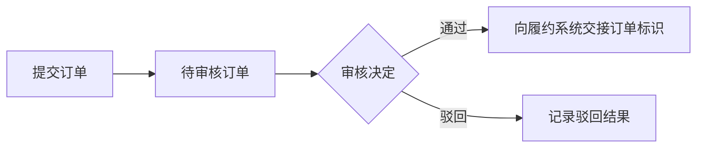
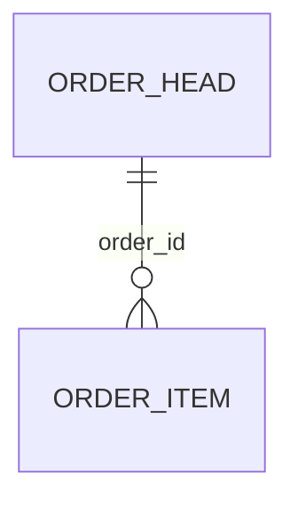

# 订单系统业务功能分析

> 完整分析模式：提交、审核详细分析，普通查询与日志概览。虚构示例，仅展示分析粒度与结构。下述模块、符号和规则均为示例设定，不是实际项目证据；真实分析须提供实际读取的依据，并在不确定内容旁明确标注。

## 一、我是谁：系统定位

### 1.1 系统是什么

管理订单提交与审核，把录入的订单转为可供履约使用的审核结果。

### 1.2 输入与输出

- 输入：业务人员录入的订单、审核人员的意见。
- 输出：订单状态、审核记录以及对履约系统的交接请求。

### 1.3 职责边界

订单提交与审核在本系统内处理；发货、结算及履约系统内部处理不在此处展开。

## 二、为谁做：用户与使用方式

| 对象 | 如何参与 | 通过系统解决什么问题 |
|---|---|---|
| 业务人员 | 录入并提交订单； 查询处理进度 | 将业务资料交给审核，获得处理结果 |
| 审核人员 | 查看待审核资料并记录决定 | 确认订单是否可交接履约 |
| 管理员 | 查询操作日志 | 获取问题排查所需记录 |

本虚构示例只设定内部人员参与，未设定实际运营阶段或客户登录入口。履约系统是业务接收系统，其交接规则放在第四章。

### 2.1 用户如何参与业务

这是虚构示例中的参与过程；审核通过后与履约系统的交接见第四章。

## 三、做什么：业务范围与能力

| 业务能力 | 解决的问题 | 业务结果 |
|---|---|---|
| 订单提交 | 将录入完成的订单交给审核环节 | 待审核订单 |
| 订单审核 | 决定订单是否进入后续履约 | 审核通过或驳回结果 |
| 订单查询 | 查看订单内容与处理进度 | 订单及当前状态 |
| 日志查询 | 为操作排查提供记录 | 符合条件的操作日志 |

## 四、怎么做：业务流程与模块协作

### 4.1 业务主线与模块总览

#### 4.1.1 主线流程

以下流程为虚构示例设定，不是任何真实项目的事实。

为形成可供履约使用的审核结果，核心主线是“提交订单 → 审核订单 → 审核通过时向履约系统交接”。订单提交模块承担第一阶段，订单审核模块承担后两个阶段；审核驳回不进入履约交接。

订单查询支撑业务人员查看各阶段结果，日志管理辅助排查，均不构成必须依次执行的后续业务步骤。因此按“提交 → 审核 → 查询 → 日志管理”的阅读顺序分析。

#### 4.1.2 模块划分

| 模块 | 主线位置 | 主要职责 | 主要功能 |
|---|---|---|---|
| 订单提交 | 提交阶段 | 将草稿转为待审核订单 | 提交校验、金额汇总、状态更新 |
| 订单审核 | 审核及交接阶段 | 记录决定并请求履约交接 | 审核通过或驳回、履约请求 |
| 订单查询 | 各阶段结果查询 | 展示订单数据 | 分页查询、详情查询 |
| 日志管理 | 操作排查 | 提供操作记录 | 日志查询 |

这里的业务模块不等于 api、service 等工程模块。

### 4.2 订单提交

#### 4.2.1 职责与触发

订单提交模块负责把业务人员录入的草稿订单转为待审核订单：校验订单可提交、汇总金额、更新状态。审核决定不在本模块。

入口：`POST /order/submit` 提交订单

#### 4.2.2 涉及的数据表

| 表名 | 描述 | 存什么 |
|---|---|---|
| order_head | 订单主表 | 订单主记录：标识、金额快照、状态 |
| order_item | 订单明细表 | 订单明细：商品、数量、单价，通过 order_id 关联主记录 |

字段较多时每表一个折叠块，按语义分组，示例（虚构）：

<b>order_head — 订单主表</b>

<strong>标识与状态</strong>

<ul><li><code>id</code> 主键</li><li><code>order_no</code> 订单编号</li><li><code>status</code> 订单状态（10草稿 20待审核 30已通过 40已驳回）</li></ul>

<strong>公共审计字段</strong>

<ul><li><code>create_time</code> 创建时间</li><li><code>update_time</code> 更新时间</li></ul>

#### 4.2.3 提交处理与数据落点

按订单标识读取订单和明细，检查订单仍为草稿且明细非空，按明细数量与单价汇总金额，更新订单金额和状态，返回提交结果。订单标识是后续审核关联同一业务对象的依据。校验失败时不修改订单。

数据落点：更新 order_head 的金额与状态为待审核，不新增另一份订单。

<b>依据（源码参考）</b>

<ul><li>提交处理：src/main/java/com/example/order/service/impl/OrderServiceImpl.java</li></ul>

（虚构示例：真实分析须替换为实际读取过的文件，路径只到文件、用模块相对路径。）

### 4.3 订单审核

#### 4.3.1 职责与触发

订单审核模块负责记录审核决定；审核通过时向履约系统交接订单标识。

入口：`POST /order/{id}/review` 提交审核决定

#### 4.3.2 涉及的数据表

| 表名 | 描述 | 存什么 |
|---|---|---|
| order_head | 订单主表 | 订单主记录，复用 4.2，此处更新审核结果状态 |
| review_record | 审核记录表 | 审核记录：审核意见与决定，通过订单标识关联 |

#### 4.3.3 审核处理与数据落点

按订单标识读取待审核订单，保存审核意见并更新为通过或驳回。示例设定：本地事务提交后，审核通过时通过订单标识向履约系统发起请求，协作过程见 4.6。

业务规则：仅待审核订单允许审核，审核通过或驳回均需记录审核意见。审核记录与订单状态更新位于同一本地事务，该事务范围影响结果一致性，因此需要说明。

异常（虚构设定）：远端调用失败不撤销已提交的审核结果，而是另存推送待处理记录。待确认：自动重试、人工补发以及重复接收规则尚无证据；不能根据本地请求成功就断言远端已落库。

<b>依据（源码参考）</b>

<ul><li>审核处理：src/main/java/com/example/order/service/impl/ReviewServiceImpl.java</li></ul>

### 4.4 订单查询

| 功能 | 触发方式 | 作用与结果 |
|---|---|---|
| 分页查询 | 用户提交查询条件 | 读取订单并返回分页列表，不写库 |
| 详情查询 | 用户打开指定订单 | 按订单标识读取主记录和明细，组装返回，不写库 |

入口：

- `GET /order/page` 分页查询
- `GET /order/{id}` 详情查询

普通查询简述即可，不逐字段、逐 Mapper 方法展开。真实实现若存在数据权限过滤，则补充该规则。

<b>依据（源码参考）</b>

<ul><li>查询实现：src/main/java/com/example/order/service/impl/OrderQueryServiceImpl.java</li></ul>

### 4.5 日志管理

管理员提交查询条件后，读取已有操作日志并返回分页列表，不写库。

入口：`GET /operation-log/page` 分页查询操作日志

待确认：本例只覆盖查询入口，日志采集方式尚未核实。

该能力辅助问题排查，与订单流转关联较弱，因此位于模块分析末尾。日志查询不承担审核失败恢复，不能据此推断存在补偿机制。

### 4.6 跨模块协作流程

订单提交模块将订单更新为待审核；审核模块读取该状态后处理审核。两者以订单标识及持久化状态交接，不代表提交方法直接调用审核方法。

审核通过后，审核模块向履约系统交接订单标识。履约系统内部如何处理和持久化不在本地证据范围内。调用失败时，本地审核结果与交接结果可能不一致，需要说明待处理记录的实际用途。

### 4.7 分析结论与待确认事项

系统面向录入和审核人员，通过订单状态及审核记录管理提交与审核，并向履约系统交接通过的订单。订单查询直接支撑业务查看结果，日志管理为管理员提供排查辅助，两者的查询入口只读取并返回数据。

真实分析应为关键结论补充实际文件和符号，并就近标注推断及待确认内容。还需核实远端接收语义、推送待处理记录的后续处理及重复请求规则；这些未知项不能写成已实现机制。
