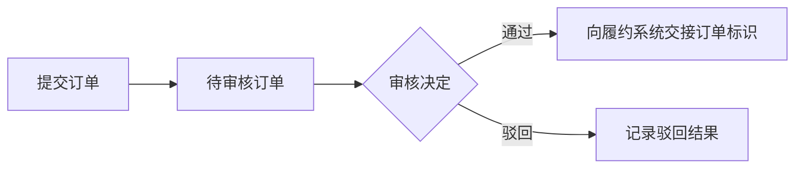

# 订单系统业务功能分析

> 虚构格式示例，不是实际项目事实。示例设定用户选择“先看业务主线与模块总览”；本轮仅做概览，后续模块标题不代表已完成分析。

## 一、我是谁：系统定位

### 1.1 系统是什么

管理订单提交与审核，把录入的订单转为可供履约使用的审核结果。

### 1.2 输入与输出

- 输入：业务人员录入的订单、审核人员的意见。
- 输出：订单状态、审核记录以及对履约系统的交接请求。

### 1.3 职责边界

订单提交与审核在本系统内处理；发货、结算及履约系统内部处理不在此处展开。

## 二、为谁做：用户与使用方式

| 对象 | 如何参与 | 通过系统解决什么问题 |
|---|---|---|
| 业务人员 | 录入并提交订单； 查询处理进度 | 将业务资料交给审核，获得处理结果 |
| 审核人员 | 查看待审核资料并记录决定 | 确认订单是否可交接履约 |
| 管理员 | 查询操作日志 | 获取问题排查所需记录 |

本虚构示例只设定内部人员参与，未设定实际运营阶段或客户登录入口。履约系统是业务接收系统，其交接规则放在第四章。

### 2.1 用户如何参与业务

这是虚构示例中的参与过程；审核通过后与履约系统的交接见第四章。

## 三、做什么：业务范围与能力

| 能力 | 主要业务产出 |
|---|---|
| 订单提交 | 待审核订单 |
| 订单审核 | 审核结果及对履约系统的交接 |
| 订单查询 | 订单信息与处理状态 |
| 日志查询 | 用于排查的操作记录 |

## 四、怎么做：业务流程与模块协作

### 4.1 业务主线与模块总览

#### 4.1.1 主线流程

以下流程为虚构示例设定，不是任何真实项目的事实。

示例主线为“订单提交 → 订单审核 → 审核通过后交接履约系统”，交接暂归订单审核模块。查询支撑各阶段的信息查看，日志管理辅助排查；后两者不是主线必须依次执行的步骤。

#### 4.1.2 模块划分

| 模块 | 主线位置 | 主要职责 | 主要功能 |
|---|---|---|---|
| 订单提交 | 提交阶段 | 形成待审核订单 | 订单提交 |
| 订单审核 | 审核及交接阶段 | 处理审核决定并请求履约交接 | 审核通过或驳回、履约请求 |
| 订单查询 | 各阶段结果查询 | 展示订单及状态 | 分页查询、详情查询 |
| 日志管理 | 操作排查 | 为排查提供操作记录 | 日志查询 |

本轮只做业务总览，模块详情尚未展开；履约交接暂归订单审核模块。示例依据为提交、审核的入口与关键实现片段，以及查询、日志入口定义；真实分析须将实际文件及符号附在对应结论旁。以下仅保留后续模块标题。

### 4.2 订单提交

### 4.3 订单审核

### 4.4 订单查询

### 4.5 日志管理
