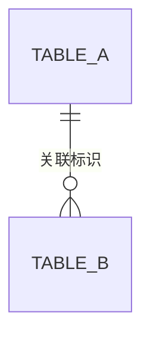

# {分析对象名称}业务功能分析

> 模板使用说明（交付时删除）：以下表格是可选表达方式，按信息增删列；简短内容用文字，流程可用有序列表，不要求每节建表。完整分析按需填写各节；先总览模式只填写到 4.1，后续仅生成实际模块名称的三级标题，不输出模块正文、子标题、空表、详细跨模块流程或最终分析结论；在 4.1 绘制概览级主线图。标题下可用一条短注说明阶段，不单设范围与依据章节。

## 一、我是谁：系统定位

### 1.1 是什么

用业务语言解释分析对象的类型与作用。

### 1.2 解决什么问题

按业务问题分点说明，不把技术动作列成业务目标。

### 1.3 围绕什么业务

概括业务主线及主要对象，按需要用短列表交代资料来源与处理结果，不写死主线数量。

### 1.4 在上层业务中承担哪一环

用简洁文字说明行业或上层业务从哪里开始、经过哪些阶段，以及本系统承担的环节。系统级分析需要帮助读者建立位置感或用户要求时配流程图；明确行业示意与源码流程的区别，不能将所有行业阶段标成本系统已实现。可按“业务维度：承担的环节”和“系统维度：上下游协同”组织，依据实际资料说明职责与交接；两类图分别标明业务示意或系统协作，未确认的直接接口不画成已实现。资料中的系统名称不同于当前对象时说明边界，未知项就近标注待用户提供的具体信息。职责边界就近说明；小型对象可合并，不保留空标题。

## 二、为谁做：用户与使用方式

| 对象 | 如何参与 | 通过系统解决什么问题 |
|---|---|---|
| 实际服务对象或直接操作人员 | 需求、资料或操作 | 对应业务结果 |

产品阶段和不确定的服务设想用短注说明，不默认另设阶段、岗位分工、协作系统和源码入口章节。服务接受方不等于系统账号用户；外部系统交接放到相关业务流程。单元格有多个独立事项时可用 ` ` 换行。

### 2.1 用户如何参与业务

有客户委托、内部代办、多方参与或用户要求时，用 Mermaid 图说明“谁提出需求与资料 → 谁通过系统完成哪些办理环节 → 形成什么结果 → 交给谁”。多类用户可共享办理过程，但需求来源及结果接收者须清楚；拟定模式明确标注，未知交接不画成已实现。避免只画人物之间的抽象箭头，也不在本节重复第四章的源码细节。

## 三、做什么：业务范围与能力

较长清单用三级标题分组为核心业务、直接支撑、通用管理并拆表。按核心业务流程阶段排列能力，再列直接支撑能力，最后列与主线关联较弱的通用管理能力，与第四章模块顺序对应。多条独立主线分别组织。使用方差异影响理解时才补充，不固定增加使用方、主要输入或证据状态列。

| 业务能力 | 解决的问题 | 业务结果 |
|---|---|---|
| 实际能力 | 具体业务问题 | 产出或状态 |

## 四、怎么做：业务流程与模块协作

### 4.1 业务主线与模块总览

按需使用四级标题区分具体业务主线与模块划分。主线关联在对应流程旁说明，不默认单设“交叉与共享支撑”“源码定位”“后续展开重点”或“待确认事项”小节；重要限制就近附在业务结论旁，源码依据单独放入灰色折叠块（依据（源码参考）），不与正文混排。

系统级、多主线或用户要求时提供 Mermaid 流程图。图以已核实的交接为依据，使用业务节点和条件标签；未知关系不画成确定箭头，图后简述关键条件与缺口。

简述“解决什么问题 → 业务如何分阶段进行 → 产生什么结果”，对应到相关模块。明确并行、分支或循环，不强行串联独立流程；先后关系证据不足时就近标记待确认。

| 模块 | 主线位置 | 主要职责 | 主要功能 |
|---|---|---|---|
| 实际业务名称 | 具体业务阶段或作用（已分组时不重复分类） | 职责及必要边界 | 功能概括 |

总览与模块章节同序：核心模块按流程阶段排列，直接支撑模块紧随所支撑主线，通用管理模块位于模块分析末尾。分类依据系统职责。若职责与功能列实际内容重复，可合并；代码位置不作为固定列。

阶段和覆盖用简短文字统一说明，例如“本轮完成主线与模块划分，模块详情尚未展开”。个别模块的边界疑点、排除项或其他例外单独列明，不能把计划写成已完成。

先总览模式仅将影响当前理解的划分疑点和证据缺口附在相关内容旁，不罗列常规确认问题或后续分析任务；随后只生成模块标题，停止详细分析。以下详细内容仅供完整分析或用户要求继续后使用。

### 4.2 {业务模块名称}

#### 4.2.1 职责与触发

先解释模块“是什么、负责什么”，再说明“由谁触发”（用户操作 / 接口 / 定时任务 / 消息等），以及交给其他模块的事项。普通 CRUD 可在本节说明完毕；输入、关键限制有业务意义时就近补充。

| 功能 | 触发方式 | 作用与结果 |
|---|---|---|
| 实际功能 | 用户操作 / 接口 / 定时任务 / 消息等 | 操作的业务对象及结果 |

#### 4.2.2 涉及的数据表

落库模块先给数据表总览，后续小节直接使用表名。无落库时删除本节，用文字说明查询返回、外部交接等实际去向；未知去向就近标记待确认，不假设远端持久化。

| 表名 | 描述 | 存什么 |
|---|---|---|
| 实际表名（一律小写，代码注解/DDL 大写也转小写） | 中文表名（以 DDL 表级 COMMENT 为准，禁止凭语义概括） | 一句话说明业务内容与关联 |

一个中心表挂多个互不关联的从表导致图横向过宽时，按业务主题拆成多个上下排列的小图，每图前加粗体主题标签（erDiagram 不支持 direction，拆图是唯一可靠手段）。

字段明细按表分块折叠，块内为纯 HTML（无空行），按语义分组；类型字段附枚举，难理解的业务字段行尾补示例，审计与自明字段不加示例；折叠块标题的“表名 — 中文名”与上方清单描述列逐字一致：

<b>table_a — 中文表名</b>

<strong>标识与来源</strong>

<ul><li><code>id</code> 主键</li><li><code>source_flag</code> 来源标识（1手工 2接口），示例：接口</li></ul>

<strong>公共审计字段</strong>

<ul><li><code>create_time</code> 创建时间</li></ul>

#### 4.2.3 {功能或流程名称，名词式}

每个承载业务规则或复杂协作的功能一个小节。先解释“是什么”，再列入口（单个入口一行：`入口：\`POST /path\` 动作说明`；多个入口用“入口：”引导逐条 `- ` 列出）。

主流程平铺：简单顺序用有序列表，跨角色跨模块用 Mermaid 图（图不折叠）。流程图下方用一句引导语引出编号规则列表，说明图是骨架、列表是各环节展开：

1. **环节标签**：核心规则一句概括。
   - 子要点按需展开。

“各环节规则明细”“处理规则明细”等展开内容较长时放入灰色折叠块；异常只按业务影响展开，单个场景用文字，多个重要异常可用“异常场景 / 系统处理 / 业务影响”简表。

依据集中放在小节末尾，整体折叠：

<b>依据（源码参考）</b>

<ul><li>功能编排：src/main/java/com/example/service/impl/XxxServiceImpl.java</li></ul>

> 完整分析时，按总览顺序重复模块章节并递增编号；参与多个阶段的模块详细说明一次，其他阶段引用。简单 CRUD 保留简述及必要依据即可，不保留空表或不适用标题。先总览模式只保留计划中的模块标题。

### 4.3 跨模块协作流程（按实际模块数调整编号）

简短协作用文字说明；多个交接点需要对照时使用下表。共享流程在此统一描述，模块内引用即可。

| 来源 → 接收方 | 交接条件 | 交接内容与方式 | 后续结果 |
|---|---|---|---|
| 实际模块或系统 | 触发或生效条件 | 数据/业务结果及调用、消息或人工等方式 | 接收后的实际结果 |

关键结论附必要依据；未知远端行为明确标记，不推断远端落库。无跨模块协作则省略本节。

### 4.4 分析结论与待确认事项（按实际模块数调整编号）

简要概括定位、用户、能力及核心处理方式。没有实质待确认事项时省略下表，只有一项可用文字。

| 问题 | 影响 | 核实方式 |
|---|---|---|
| 实际待确认或未完成项 | 对当前结论的影响 | 所缺证据及获取方式 |

事实须有依据，推断和待确认内容明确标注；不重复铺设“已确认”标签，静态源码结论不等于线上运行结果。
